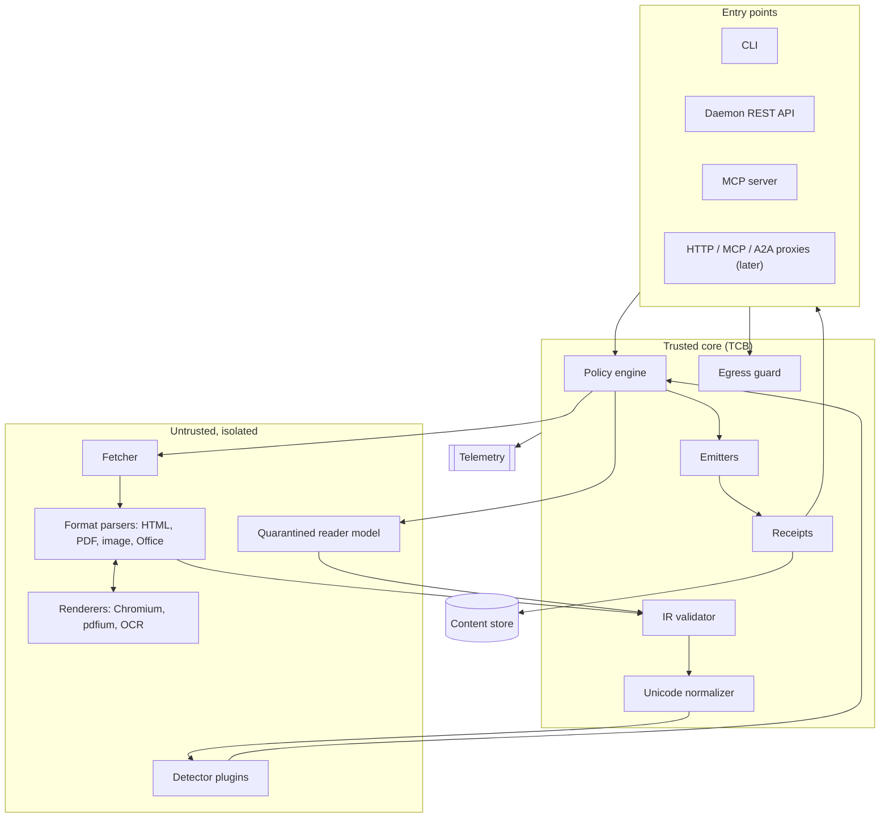
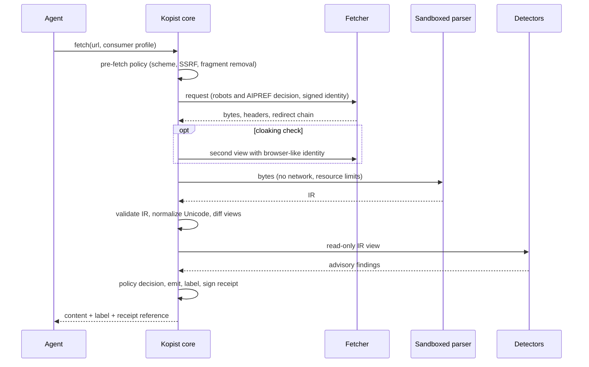

# Architecture

Status: **design**. Nothing described here is implemented yet. Crate names are provisional.

## 1. Overview

Kopist has a narrow waist: a closed **content intermediate representation (IR)** and the
**Agent Content Trust label and receipt**. Everything else is a replaceable module around them.

## 2. Components

| Component | Provisional crate | Trust | Isolation tier |
|---|---|---|---|
| IR and label types, IR validator | `kopist-core` | TCB, no `unsafe` | in-process |
| Unicode normalizer | `kopist-unicode` | TCB | in-process |
| Emitters (Clean Markdown, text, JSON, safe HTML) | `kopist-emit` | TCB | in-process |
| Receipt build, sign, verify | `kopist-receipt` | TCB | in-process (also compiled to WebAssembly) |
| Policy engine | `kopist-policy` | TCB | in-process |
| Egress guard | `kopist-egress` | TCB | in-process |
| Fetcher | `kopist-fetch` | network-facing, no content parsing | in-process with strict limits |
| Format parsers | `kopist-html`, `kopist-pdf`, `kopist-image`, `kopist-office` | untrusted | T0 to T3 |
| Renderer driver | `kopist-render` | untrusted | T2 or T3 |
| Detector host | `kopist-detect` | untrusted, advisory | T1 |
| Quarantined reader | `kopist-extract` | output untrusted, schema-validated | separate process |
| Sandbox abstraction | `kopist-sandbox` | TCB | n/a |
| Content store | `kopist-store` | integrity via hashes | in-process |
| Entry points | `kopist-cli`, `kopist-server`, `kopist-mcp`, later `kopist-proxy`, `kopist-a2a` | TCB edge | in-process |

A parser can only return IR, which the trusted core validates against the schema and size limits.
A compromised parser can misreport content, which is no worse than the untrusted content itself, but
it cannot escape its sandbox or produce output the IR cannot represent. Isolation tiers are described
in [design/isolation-tiers.md](design/isolation-tiers.md).

## 3. Ingest data flow

Step by step:

1. **Request.** The target (URL, upload, MCP result or agent message part) and a consumer profile
   (model family, modalities, maximum image size, context budget).
2. **Pre-fetch policy.** Scheme and host rules; SSRF protection with DNS pinning and blocking of
   private, loopback, link-local and metadata addresses; URL fragments removed; prompt-like query
   parameters flagged.
3. **Usage decision.** robots.txt ([RFC 9309](https://www.rfc-editor.org/rfc/rfc9309)) and IETF
   AI preferences ([AIPREF](https://ietf-wg-aipref.github.io/drafts/draft-ietf-aipref-vocab.html))
   are evaluated. Rules differ for "agent acting for a user" and "crawler". The decision is recorded.
4. **View A.** Fetch with a declared identity, optionally signed with HTTP Message Signatures
   ([RFC 9421](https://www.rfc-editor.org/rfc/rfc9421)) following
   [Web Bot Auth](https://github.com/cloudflare/web-bot-auth). Size, time, redirect and decompression
   limits apply.
5. **View B (optional).** A second fetch with a browser-like identity for cloaking detection. It obeys
   the same usage decision and never circumvents access controls.
6. **Parse.** The sniffed content type selects a pipeline, which runs in its isolation tier and emits
   IR ([design/reconstruction-pipelines.md](design/reconstruction-pipelines.md)).
7. **Validate and normalize.** The core validates the IR and applies Unicode normalization.
8. **Compare views.** A semantic diff between views A and B produces a `cloaking` finding when they
   diverge beyond declared alternates.
9. **Detect.** Detector plugins read the IR and return advisory findings.
10. **Decide.** The policy engine chooses `allow`, `allow-labeled`, `typed-only` or `block`, and the
    emitter and model binding ([design/policy.md](design/policy.md)).
11. **Emit and sign.** Output, label and receipt are produced and stored.
12. **Observe.** An OpenTelemetry event is emitted with hashes, never content, by default.

## 4. Content IR

A closed, versioned document model:

- `Document { meta, blocks[], assets[], provenance_map }`
- Blocks: `Heading`, `Paragraph` (inline: text, emphasis, code, link), `List`, `Table`, `CodeBlock`
  (language tag from an allowlist), `Quote`, `ImageRef` (sanitized asset, OCR text and alt text,
  each labeled by source), `Note`. Later: `MediaTranscript`.
- Every block keeps a source span (DOM path, PDF page and box, or pixel region) for explanations.
- Unknown block types are dropped. This lets future versions add types safely.

The default output profile is **Clean Markdown**: restricted CommonMark without raw HTML and without
inline image syntax. Links are emitted as numbered references with a normalized link table; images
are emitted as asset handles.

## 5. Egress guard

Every outbound action of the consumer passes the guard: HTTP requests (proxy), MCP tool calls (MCP
proxy), SDK hooks, rendered output and writes to agent configuration. See
[design/egress-guard.md](design/egress-guard.md).

## 6. Typed extraction

A quarantined reader model without tools, network or secrets turns content handles into
schema-validated values. See [design/typed-extraction.md](design/typed-extraction.md).

## 7. Content store and dataset integrity

- Content-addressed storage keyed by raw and IR hashes; SQLite index and blob directory locally,
  S3-compatible storage on servers. Raw bytes are kept only when policy allows, encrypted at rest.
- Retrieval chunks carry a Merkle inclusion proof against their document receipt.
- Dataset manifests (JSON Lines) list URL, fetch time, digests, receipt and usage signal, and can be
  referenced from a [CycloneDX](https://cyclonedx.org/) machine-learning bill of materials.
- Re-fetching and comparing hashes detects split-view poisoning
  ([Carlini et al., 2023](https://arxiv.org/abs/2302.10149)).

## 8. Interfaces

| Interface | Phase | Notes |
|---|---|---|
| CLI (`kopist fetch`, `inspect`, `diff`, `verify`, `why`, `bench`) | 0 to 1 | First deliverable |
| Daemon REST API (`/v1/fetch`, `/v1/ingest`, `/v1/extract`, `/v1/egress/check`, `/v1/verify`) | 1 | `127.0.0.1` or Unix socket |
| MCP server (tools `fetch`, `read_document`, `extract`, `inspect`) | 1 | stdio and Streamable HTTP |
| Agent integrations (Claude Code, Codex CLI, Cursor, VS Code) | 1 | Replace native fetch tools |
| Python and TypeScript SDKs | 1 to 2 | Client, verifier, label types |
| MCP proxy (definition pinning, labeled results, flow rules) | 2 | Wraps upstream servers |
| HTTP forward proxy | 2 | Opt-in TLS termination |
| Agent2Agent proxy | 3 | Signed Agent Cards |
| Browser-agent adapters (Playwright, browser-use) | 3 | Observation sanitizer and action guard |

## 9. Dependency policy

Allowed licenses: Apache-2.0, MIT, BSD, ISC, Zlib, Unicode-3.0; MPL-2.0 only as an unmodified
dependency. AGPL and GPL components are not linked into Kopist processes. Enforcement with
`cargo-deny` from the first line of code ([ADR 0003](adr/0003-licensing-reuse-dco.md)).

## 10. Deployment modes

Single binary on a laptop; sidecar container; team service (Helm chart); CI mode (GitHub Action for
scanning repositories and skills); embedded library (Rust or WebAssembly).
