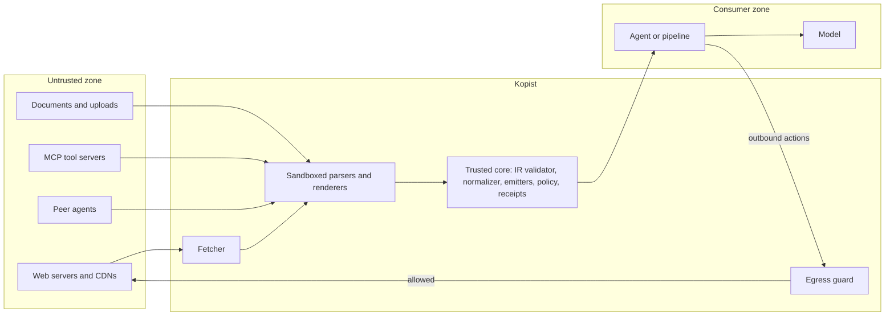

# Threat model

Status: **draft for public review** (2026-09). Comments are welcome through issues using the
"design proposal" template.

## 1. System under consideration

Kopist sits between content sources (web servers, documents, tool servers, other agents) and a
consumer (an AI agent, a retrieval pipeline, a crawler). It fetches or receives content, reconstructs
it, labels it, signs a receipt, and guards the consumer's outbound actions.

Trust boundaries:

- **TB1** between the untrusted zone and the fetcher (network).
- **TB2** between sandboxed parsers and the trusted core (only validated IR crosses it).
- **TB3** between Kopist and the consumer (labeled output and receipts cross it).
- **TB4** between the consumer and the outside world (every outbound action crosses the egress guard).

## 2. Assets

| Asset | Why it matters |
|---|---|
| Agent intent and control flow | Hijacking turns the agent against its user |
| User data and secrets reachable by the agent | Target of exfiltration |
| The consumer's machine and configuration | Target of code execution |
| Integrity of retrieved knowledge and datasets | Target of poisoning |
| Receipts and labels | Must not be forgeable, or trust decisions fail |
| Kopist itself (parsers, keys, cache) | A compromised gateway compromises every consumer |

## 3. Adversaries

| ID | Adversary | Capabilities |
|---|---|---|
| A1 | Web publisher or page contributor | Controls page content, comments, CSS, images, documents |
| A2 | Cloaking operator | Serves different content to AI agents than to humans |
| A3 | Dataset poisoner | Buys expired domains, edits crowd-sourced pages before snapshots, mass-publishes content |
| A4 | Malicious tool or skill author | Publishes MCP servers, tool descriptions, agent skills or packages |
| A5 | Compromised or malicious peer agent | Sends messages and artifacts over agent-to-agent channels |
| A6 | Network attacker | Observes or modifies traffic where TLS is absent or broken |
| A7 | Adaptive attacker | Optimizes any of the above against published defenses, including automated search |

Out of scope: an attacker with code execution on the host running Kopist, and a malicious model
provider. Kopist cannot protect a consumer from its own model weights.

## 4. Attack classes

Legend for the "Control" column: **G** = covered by a guarantee in the
[guarantee registry](security/guarantees.md), **A** = advisory detection and labeling,
**P** = constrained by policy or egress control, **N** = not addressed.

| ID | Attack class | Documented examples | Taxonomy | Control |
|---|---|---|---|---|
| AC-01 | Hidden text in HTML (CSS hiding, off-screen, low contrast, comments) | White-on-white text changed ChatGPT Search answers ([TechCrunch, 2024-12-26](https://techcrunch.com/2024/12/26/chatgpt-search-can-be-tricked-into-misleading-users-new-research-reveals/)); hidden page text hijacked Comet ([Brave, 2025](https://brave.com/blog/comet-prompt-injection/)) | LLM01, ASI01 | G |
| AC-02 | Invisible Unicode (tag characters, zero-width, bidi controls, variation selectors) | ASCII smuggling with Unicode tags ([Rehberger, 2024](https://embracethered.com/blog/posts/2024/hiding-and-finding-text-with-unicode-tags/)) | LLM01 | G |
| AC-03 | Instructions in URL fragments or query parameters | HashJack ([Cato Networks, 2025-11-25](https://www.catonetworks.com/blog/cato-ctrl-hashjack-first-known-indirect-prompt-injection/)); AI Recommendation Poisoning ([Microsoft, 2026-02-10](https://www.microsoft.com/en-us/security/blog/2026/02/10/ai-recommendation-poisoning/)) | LLM01, ASI06 | G (fragments), A (parameters) |
| AC-04 | Cloaking toward AI agents | AI-targeted cloaking ([SPLX, 2025](https://splx.ai/blog/ai-targeted-cloaking-openai-atlas)) | LLM01, LLM04 | A |
| AC-05 | Visible instructions inside legitimate-looking content | Indirect prompt injection in general ([OWASP LLM01:2025](https://owasp.org/www-project-top-10-for-large-language-model-applications/assets/PDF/OWASP-Top-10-for-LLMs-v2025.pdf)) | LLM01, ASI01 | A, P |
| AC-06 | Image-scaling payloads | Text revealed after downscaling ([Trail of Bits, 2025-08-21](https://blog.trailofbits.com/2025/08/21/weaponizing-image-scaling-against-production-ai-systems/)) | LLM01 | G |
| AC-07 | Text and semantic instructions in images (typography, rebus, puzzles) | NVIDIA AI Red Team ([2025](https://developer.nvidia.com/blog/securing-agentic-ai-how-semantic-prompt-injections-bypass-ai-guardrails)); faint text in screenshots ([Brave, 2025-10-21](https://brave.com/blog/unseeable-prompt-injections/)) | LLM01 | A, P |
| AC-08 | Steganographic payloads in images | 24 to 32 % attack success in experiments ([arXiv 2507.22304](https://arxiv.org/abs/2507.22304)) | LLM01 | A (reduced by re-encoding) |
| AC-09 | PDF hidden content and active content (invisible render mode, off-page text, incremental updates, JavaScript, attachments) | General document-borne injection; mitigations follow CDR practice ([Dangerzone](https://github.com/freedomofpress/dangerzone)) | LLM01 | G |
| AC-10 | Office documents (macros, hidden sheets, comments, tracked changes) | Same class as AC-09 | LLM01 | G (planned Phase 2) |
| AC-11 | Payloads in metadata (EXIF, XMP, document properties) | Same class as AC-09 | LLM01 | G |
| AC-12 | Exfiltration through rendered output (markdown images, links, link previews) | Link-preview exfiltration ([PromptArmor, 2026-02-10](https://www.promptarmor.com/resources/llm-data-exfiltration-via-url-previews-(with-openclaw-example-and-test))); markdown image exfiltration ([Rehberger, 2025](https://embracethered.com/blog/posts/2025/amp-code-fixed-data-exfiltration-via-images/)) | LLM02, LLM05 | G (Kopist-rendered output), P |
| AC-13 | Exfiltration through tool calls and requests (the "lethal trifecta") | [Willison, 2025-06-16](https://simonwillison.net/2025/Jun/16/the-lethal-trifecta/); EchoLeak ([arXiv 2509.10540](https://arxiv.org/html/2509.10540v1)); GitHub MCP ([Invariant Labs](https://invariantlabs.ai/blog/mcp-github-vulnerability)) | LLM02, ASI02 | P |
| AC-14 | Code execution through agent configuration writes | [CVE-2025-53773](https://msrc.microsoft.com/en-US/security-guidance/advisory/CVE-2025-53773); Cursor CVE-2025-54135 and CVE-2025-54136 ([Tenable](https://www.tenable.com/blog/faq-cve-2025-54135-cve-2025-54136-vulnerabilities-in-cursor-curxecute-mcpoison)); agent framework RCE ([Microsoft, 2026-05-07](https://www.microsoft.com/en-us/security/blog/2026/05/07/prompts-become-shells-rce-vulnerabilities-ai-agent-frameworks/)) | ASI05 | P |
| AC-15 | Tool poisoning and rug pulls in MCP | Hidden instructions in tool descriptions, definitions swapped after approval ([CSA research note](https://labs.cloudsecurityalliance.org/research/csa-research-note-mcp-tool-poisoning-ai-agent-exfiltration-2/)) | ASI02, ASI04 | G (definition pinning), A |
| AC-16 | Malicious agent skills and packages | ClawHavoc ([Koi Security, 2026-02](https://www.koi.ai/blog/clawhavoc-341-malicious-clawedbot-skills-found-by-the-bot-they-were-targeting)) | ASI04 | A |
| AC-17 | Agent-to-agent session smuggling and covert channels | [Unit 42, 2025](https://unit42.paloaltonetworks.com/agent-session-smuggling-in-agent2agent-systems/) | ASI07 | P (planned Phase 3) |
| AC-18 | Training and retrieval poisoning (split-view, frontrunning, bulk narratives) | [Carlini et al., 2023](https://arxiv.org/abs/2302.10149); [Anthropic, 2025](https://www.anthropic.com/research/small-samples-poison); [NewsGuard, 2025](https://www.newsguardtech.com/special-reports/moscow-based-global-news-network-infected-western-artificial-intelligence-russian-propaganda/) | LLM04, ASI06 | G (hash integrity), A |
| AC-19 | Exploitation of Kopist's own parsers | Generic parser attacks | n/a | Isolation, fuzzing |
| AC-20 | Server-side request forgery through the fetcher | Generic SSRF | n/a | G |
| AC-21 | Receipt forgery, downgrade or replay | Generic signature attacks | n/a | G |
| AC-22 | Resource exhaustion (decompression bombs, huge documents) | Generic | n/a | G (limits) |

Taxonomy identifiers refer to the
[OWASP Top 10 for LLM Applications 2025](https://owasp.org/www-project-top-10-for-large-language-model-applications/)
(LLMxx) and the
[OWASP Top 10 for Agentic Applications 2026](https://genai.owasp.org/resource/owasp-top-10-for-agentic-applications-for-2026/)
(ASIxx). MITRE ATLAS technique AML.T0051 (LLM prompt injection) applies to AC-01 to AC-09.

## 5. The central split: hidden channels versus visible instructions

Reconstruction removes **hidden channels**: content that a human reviewer would not see but a model
would read (AC-01, AC-02, AC-03 fragments, AC-06, AC-09, AC-11). These can be covered by guarantees,
because the IR simply has no way to represent them.

Reconstruction cannot remove **visible instructions** (AC-05, AC-07): a paragraph that says "ignore
your instructions" is legitimate text as far as any parser is concerned. Kopist handles this class
by:

- labeling the content as untrusted prose so the consumer can treat it as data;
- offering typed extraction, so the privileged agent does not read the prose at all;
- constraining consequences through the egress guard and the Rule of Two.

Results for both classes are measured and published separately ([evaluation](evaluation.md)).
Public statements never merge them into a single "protection rate".

## 6. Assumptions

- The host operating system and the Kopist binary are not compromised.
- The consumer actually routes its content and outbound actions through Kopist. Kopist cannot guard
  channels that bypass it; integration guides aim to make bypass difficult.
- Signing keys are stored with operating-system protection or in hardware.
- TLS certificate validation works as specified.

## 7. Residual risks

- Semantic attacks in visible content remain possible; they are reduced, not eliminated.
- Steganography cannot be ruled out; re-encoding reduces known techniques.
- A consumer model can still reason its way into harmful actions that stay within its granted
  capabilities. Capabilities must therefore be granted narrowly.
- Detectors produce false positives and false negatives. They never make a security decision alone.

## 8. Review

This threat model will be revised with every phase of the [roadmap](../ROADMAP.md) and whenever a new
attack class is documented publicly. Each new class becomes a corpus case and, where possible, a
guarantee.
